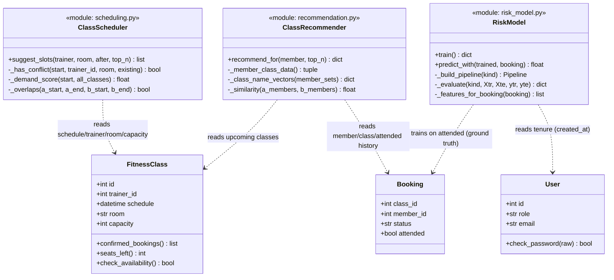
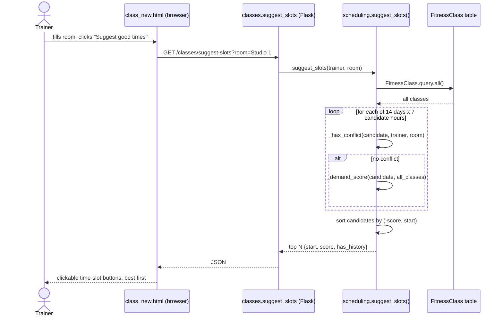
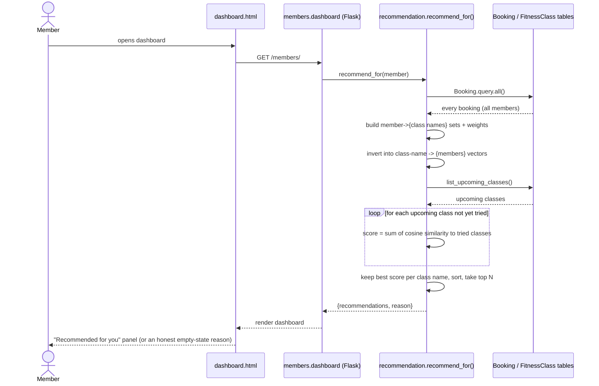
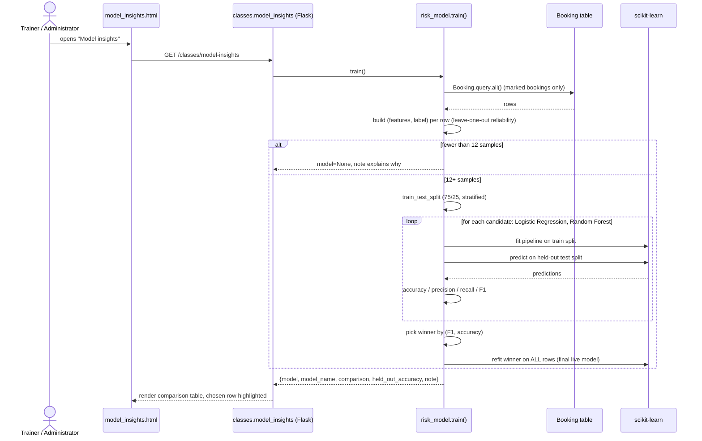
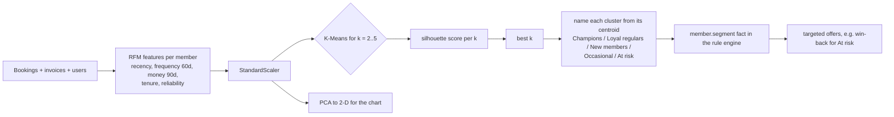
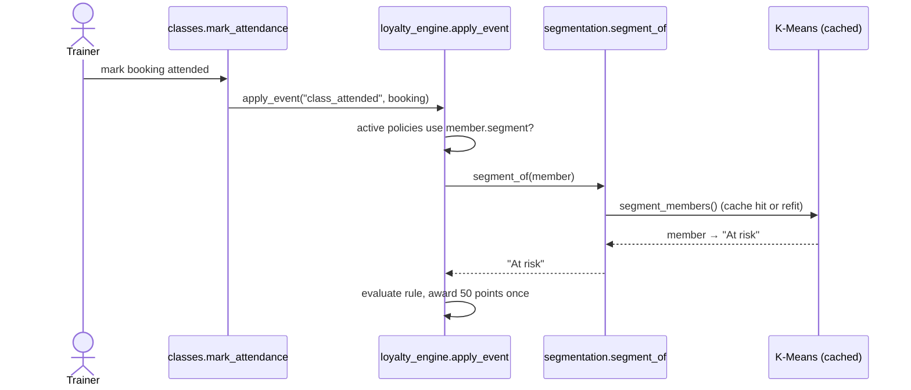

# Algorithms and Machine Learning — design notes, UML, and complexity

This document covers the three additions from the algorithm/ML deepening
pass (class scheduling optimizer, class recommendation engine, no-show
model comparison), plus the original waitlist priority queue for context.
For each: what it does, a class/sequence diagram, and an honest Big-O
analysis — in the same spirit as risk_model.py's own docstring: every claim
here should be checkable against the code, not just asserted.

Source of truth for the *behaviour* is the code and its docstrings
(gymflow/scheduling.py, gymflow/recommendation.py, gymflow/risk_model.py,
gymflow/class_manager.py); this document is the complexity/diagram layer on
top of that, not a restatement of it.

## 1. Class diagram — how the new modules relate to the existing domain

`ClassScheduler`, `ClassRecommender` and `RiskModel` are drawn as modules
(free functions), not classes, because that is what they actually are in
the code — there was no reason to wrap stateless functions in a class with
one instance, and the class-diagram boxes above are only a way to show
their public surface next to the domain model they read from.

## 2. Sequence diagram — "Suggest good times" (class scheduling optimizer)

## 3. Sequence diagram — "Recommended for you" (recommendation engine)

## 4. Sequence diagram — "Model Insights" (no-show model comparison)

## 5. Complexity analysis

Notation: `n` = size of the relevant existing data (classes, bookings, or
members) at the time of the call; all three run fresh on every request —
none of them cache a result across requests (see each module's own
docstring for why, e.g. risk_model.py's "No caching" note), so the cost
below is paid every time the page is opened, not just once.

### 5.1 `scheduling.suggest_slots()` — O(D·H·n), i.e. **O(n)**

- `D` = `LOOKAHEAD_DAYS` = 14, `H` = `len(CANDIDATE_HOURS)` = 7 — both fixed
  constants, so `D·H` = 98 candidate slots are generated every call,
  regardless of how much data exists.
- Fetching all classes (`FitnessClass.query.all()`) is `O(n)`.
- For **each** of the 98 candidates: `_has_conflict()` scans the nearby
  classes list (`O(n)`), and `_demand_score()` scans all classes again
  (`O(n)`). That is `O(n)` work per candidate, `O(D·H·n)` in total.
- The final sort is over at most 98 items — `O(98 log 98)`, a constant,
  negligible next to the scan above.
- **Overall: `O(D·H·n)`, and since `D` and `H` are fixed, this is linear in
  `n`** — the number of classes already in the system. The module's own
  docstring already flags the honest ceiling on this approach: at a much
  larger scale, an interval tree would avoid re-scanning every class for
  every candidate, but for a single gym's schedule (dozens to low hundreds
  of classes) a linear scan 98 times over is milliseconds of work, not a
  real bottleneck.
- Space: `O(D·H)` for the candidate list, `O(n)` for the classes fetched.

### 5.2 `recommendation.recommend_for()` — O(B + U·C·M)

Let `B` = total bookings ever made, `M` = members with at least one
booking, `C` = distinct class *names* a given member has tried, `U` =
number of currently upcoming classes.

- `_member_class_data()` and `_class_name_vectors()` each do one full pass
  over all bookings / member-name pairs: `O(B)`.
- The main scoring loop iterates every upcoming class (`U`) not yet tried;
  for each, it sums a cosine similarity (`_similarity()`, whose set
  intersection costs `O(min(|a|, |b|))`, bounded by `M`) against every
  class name the member has tried (`C`). That is `O(C·M)` per upcoming
  class, `O(U·C·M)` total.
- **Overall: `O(B + U·C·M)`.** At GymFlow's real scale (a handful of
  distinct class *names*, dozens of members, a few dozen upcoming classes)
  this is trivially fast — but it is stated honestly here rather than
  waved away as "O(1) because it feels instant": a gym chain with
  thousands of members and hundreds of concurrently open classes would
  need to revisit the per-request, no-caching design (see risk_model.py's
  own "would be worth revisiting" note — the same tradeoff applies here).
- Space: `O(M·C)` for the member-sets / vectors, `O(U)` for candidate
  scores.

### 5.3 `risk_model.train()` — O(n·k) feature engineering + O(n) model fitting

Let `n` = number of *marked* bookings (the training rows), `k` = the
average number of other bookings a given member has (used for that row's
leave-one-out reliability feature).

- `_training_rows()` fetches all bookings (`O(B_total)`) and, for each of
  the `n` marked ones, calls `_features_for_booking()` →
  `_member_prior_stats()`, which re-queries and filters that ONE member's
  bookings (`O(k)` for that member). Total: **`O(n·k)`** — not `O(n)`,
  stated plainly because a member with an unusually large personal booking
  history make their own rows more expensive to featurize, even though the
  *dataset* size `n` did not change.
- `train_test_split` is `O(n)`.
- Fitting `LogisticRegression` and the shallow (`max_depth=4`)
  `RandomForestClassifier` are each `O(n)` for a fixed, small number of
  features (4) and a fixed, small tree depth/count — both hyperparameters
  are constants (see `_build_pipeline()`), not scaled with `n`, so this
  does not hide an `n²` cost inside "just call sklearn."
- The two candidates are fit once each for comparison, then the winner is
  refit once more on all rows — three total fits, still `O(n)` for fixed
  hyperparameters.
- **Overall: `O(n·k)`**, dominated by the feature-engineering step above,
  not the model fitting itself. At this app's real scale (`n` in the tens
  to low hundreds of marked bookings, `k` similarly small) this is the
  same "milliseconds, no caching needed" situation the module's own
  docstring already documents.

**A real bug found and fixed while double-checking this module**: the
`n_samples >= 12` check alone was not enough to safely turn on the
held-out comparison. `train_test_split(..., stratify=y)` also needs at
least 2 examples of whichever outcome (no-show or attended) is rarer, so
it can place one example of it in the train side and one in the test
side. With only 1 (a fully plausible real situation — e.g. 12 marked
bookings where only a single one happens to be a no-show so far),
scikit-learn raised an uncaught `ValueError`, which propagated straight
out of `train()` and 500'd both the member dashboard and the trainer
roster page (Section 4.8), since neither calls it inside a try/except.
`train()` now also checks `min(n_no_show, n_samples - n_no_show) >= 2`
before attempting the split, and falls back to the same honest "not
enough data for a comparison yet" path used when there simply aren't 12
samples at all — a real, working model is still trained and returned,
just without the comparison table. Covered by a regression test in
`_devtools/test_unit.py` (section 8) that reproduces the exact 11-attended
/ 1-no-show scenario.

### 5.4 For context — `class_manager`'s existing waitlist priority queue

`_ordered_waitlist()` sorts a class's `w` waiting entries by
`(-reliability_score(member), joined_at)`. Each `reliability_score()` call
queries and filters that one member's own bookings (`O(b_m)` for member
`m`). Total: **`O(w·b_avg + w log w)`** — the module's own docstring already
states the `O(n log n)` sort; the per-entry reliability lookup is the part
worth calling out explicitly here, since it is what actually dominates for
a member with a long booking history.

## 6. No-show model, version 2 (Section 4.8 deepening)

What changed in `gymflow/risk_model.py`, and why each step matters:

| Step | What | Why |
|---|---|---|
| Features 4 → 8 | added `recent_reliability_30d`, `lead_time_days`, `class_hour`, `is_weekend` | recent behaviour and booking habits, not just lifetime averages |
| Candidates 2 → 3 | Logistic Regression, Random Forest, **Gradient Boosting** | a linear model, a bagging ensemble and a boosting ensemble |
| Class imbalance | `class_weight="balanced"` (LR, RF) | no-shows are rare (~7%); otherwise a model can win accuracy by always saying "attends" |
| Validation | held-out 25% (selection) **+ stratified k-fold CV F1 (mean ± sd)** | a single small split is noisy; CV shows how stable a score really is |
| Metrics | accuracy, precision, recall, F1, **ROC-AUC** | AUC measures ranking quality of the probabilities |
| Baseline | majority-class accuracy | proves the model beats "always guess the common outcome" |
| Diagnostics | **confusion matrix**, **ROC curve**, **permutation feature importance** | shows *where* the model is right/wrong and *what* it relies on |
| Caching | result reused until the marked-attendance data changes | dashboard and roster pages call `train()`; retraining only when needed |

Leakage protection: every history feature is computed leave-one-out (the
row's own label is never part of its own features), and
`recent_reliability_30d` only uses classes **before** the booked class.

Complexity: feature building is `O(B·b)` (B marked bookings, b bookings per
member); each candidate costs one fit on the split plus `k` CV fits, so
training is `O(C·(k+2)·fit(B))` for C=3 candidates, k≤5 folds — milliseconds
to ~1 s at gym scale, and cached afterwards (`O(B)` to check the cache key).

## 7. Member segmentation — K-Means on RFM (new, `gymflow/segmentation.py`)

Unsupervised learning that groups members by behaviour. Page:
**ML Insights → Member segments** (trainers, administrators).

- **Model selection:** k is not hard-coded; the k with the highest
  silhouette score (cluster separation, −1..1) is used. Inertia is kept for
  an elbow view.
- **Interpretability:** clusters get human names from fixed, documented
  rules on their centroid in original units (e.g. tenure < 45 days → New
  members; 21+ days since last class or reliability < 50% → At risk).
- **Integration:** the segment is a whitelisted fact in the pricing rule
  language, so marketing logic built on ML needs no code change:
  `WHEN member.segment == "At risk" THEN award_points(50)`.
- **Performance:** segment facts are only computed when an active offer uses
  `member.segment`, and the clustering is cached per day until bookings,
  invoices or members change.

Complexity: features `O(B + I + M)` (bookings, invoices, members); K-Means
is `O(n_init · iters · M · k · d)` per k, run for k=2..5 with d=5 features;
silhouette is `O(M²)` per k; PCA `O(M·d²)`. At gym scale (tens to hundreds
of members) this is well under a second.

### Sequence — targeted offer driven by the segment

